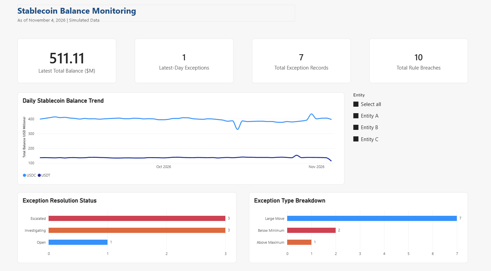
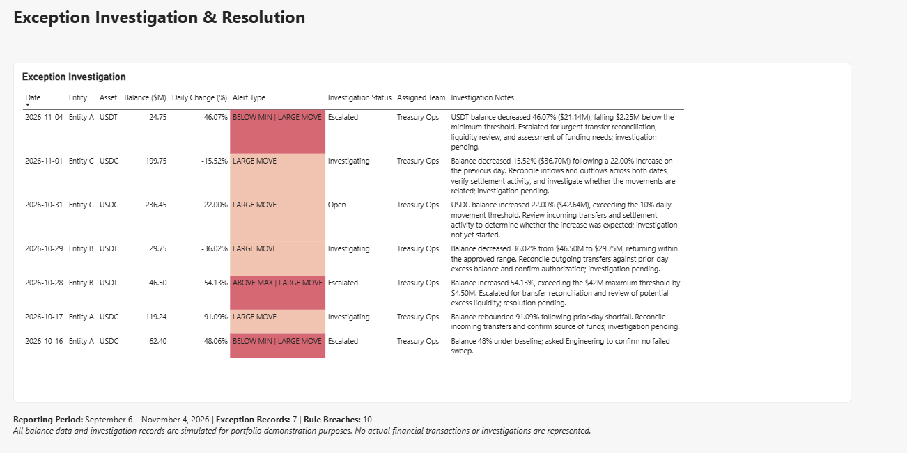

# Stablecoin Balance Monitoring & Exception Analysis

**Power BI | DAX | Power Query | Excel | Financial Operations Analytics**

An interactive financial operations dashboard designed to monitor simulated stablecoin balances, detect threshold breaches, and track exception investigations across multiple entities.

> **Disclaimer:** This project uses entirely simulated financial data and fictional investigation records. It is an independent portfolio demonstration and does not represent actual financial transactions or a production monitoring system.

## Dashboard Preview

### 1. Monitoring Overview

The Monitoring Overview provides interactive balance monitoring, KPI tracking, exception classification, and investigation status analysis.

### 2. Exception Investigation & Resolution

The investigation dashboard displays flagged transactions, daily balance movements, monitoring rule breaches, assigned teams, and simulated follow-up activities.

## Project Overview

This project demonstrates how a financial operations team could use data analytics to identify unusual stablecoin balance movements and support exception management.

The dashboard monitors USDC and USDT balances across three simulated entities over a 60-day period, combining financial metrics, risk thresholds, and investigation tracking in Power BI.

## Dataset & Key Results

| Metric | Result |
|---|---|
| Reporting Period | September 6 – November 4, 2026 |
| Monitoring Duration | 60 Days |
| Balance Records | 360 |
| Entities | 3 |
| Stablecoins | USDC, USDT |
| Latest Total Balance | $511.11 Million |
| Latest-Day Exceptions | 1 |
| Total Exception Records | 7 |
| Total Rule Breaches | 10 |

A single exception record may trigger multiple monitoring rules. Therefore, seven exception records resulted in ten individual rule breaches.

## Monitoring Rules

Three illustrative threshold-based rules were implemented:

| Rule | Threshold | Purpose |
|---|---|---|
| Below Minimum | Balance below 60% of baseline | Identify potential liquidity shortfalls |
| Above Maximum | Balance above 140% of baseline | Identify unusually high balances |
| Large Move | Absolute daily balance change exceeds 10% | Detect unusual balance movements |

These thresholds are assumptions for the simulated project, not approved institutional risk limits.

## Key Findings

**Exception Classification**

| Exception Type | Count |
|---|---|
| Large Move | 7 |
| Below Minimum | 2 |
| Above Maximum | 1 |

**Investigation Status**

| Status | Records |
|---|---|
| Escalated | 3 |
| Investigating | 3 |
| Open | 1 |

On November 4, 2026, Entity A's simulated USDT balance decreased by 46.07% to $24.75 million, triggering both the Below Minimum and Large Move monitoring rules.

The event was classified as Escalated within the simulated investigation workflow.

## Technical Implementation

### Data Preparation — Power Query

- Imported and transformed 360 daily balance records.
- Standardized data types and prepared exception-related fields.
- Applied Unpivot Columns to transform multiple monitoring rules into a category-based analytical structure.
- Created a dedicated exception analysis table containing 10 rule-breach observations.

### Data Modeling — Power BI

Created a shared entity dimension, `DimEntity`, with active one-to-many relationships connecting the balance and exception tables.

This model enables entity-level filtering across KPI cards, balance trends, exception categories, and investigation status visuals.

### KPI Development — DAX

Developed measures for:

- Latest Total Balance ($M)
- Latest-Day Exceptions
- Total Exception Records
- Total Rule Breaches

The Latest-Day Exceptions metric counts flagged records on the latest reporting date within the selected entity context. It does not represent all unresolved investigations.

### Data Visualization

Designed two interactive Power BI report pages featuring KPI cards, time-series analysis, entity slicers, conditional formatting, exception categorization, and investigation tracking.

## Quality Assurance

Validated the dashboard using individual entity filters and full-dataset comparisons.

| Entity | Latest Balance ($M) | Exception Records | Rule Breaches |
|---|---:|---:|---:|
| Entity A | 145.01 | 3 | 5 |
| Entity B | 110.09 | 2 | 3 |
| Entity C | 256.01 | 2 | 2 |
| **Total** | **511.11** | **7** | **10** |

The interactive filtering results were checked against the simulated dataset.

## How to View the Project

Download `Stablecoin_Balance_Monitoring.pbix` and open it using Microsoft Power BI Desktop.

Explore the Monitoring Overview and Exception Investigation pages, and use the Entity slicer to filter the visuals.

If a data refresh fails because of a local file path, update the source file location in Power Query to match the downloaded CSV.

## Limitations and Future Improvements

This project uses synthetic data, fixed monitoring thresholds, and simulated investigation activities.

It is not connected to live financial systems or blockchain networks and does not execute automated alerts.

Possible future improvements include automated data ingestion, exception aging metrics, configurable thresholds, SLA monitoring, and additional financial risk indicators.

## Business Value

This project demonstrates the application of financial data analytics to balance monitoring, exception detection, investigation workflows, and management reporting.

It combines banking operations concepts with analytical tools to illustrate how structured monitoring can support transparent financial oversight.
